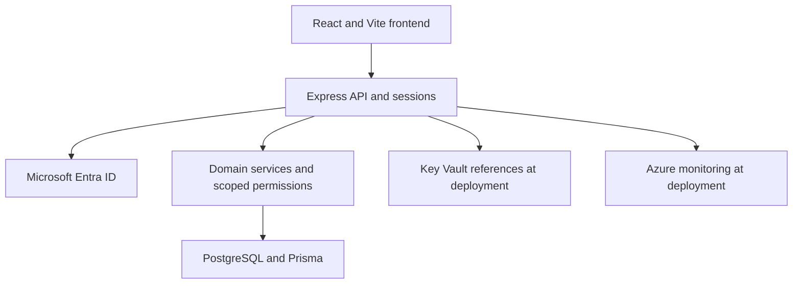
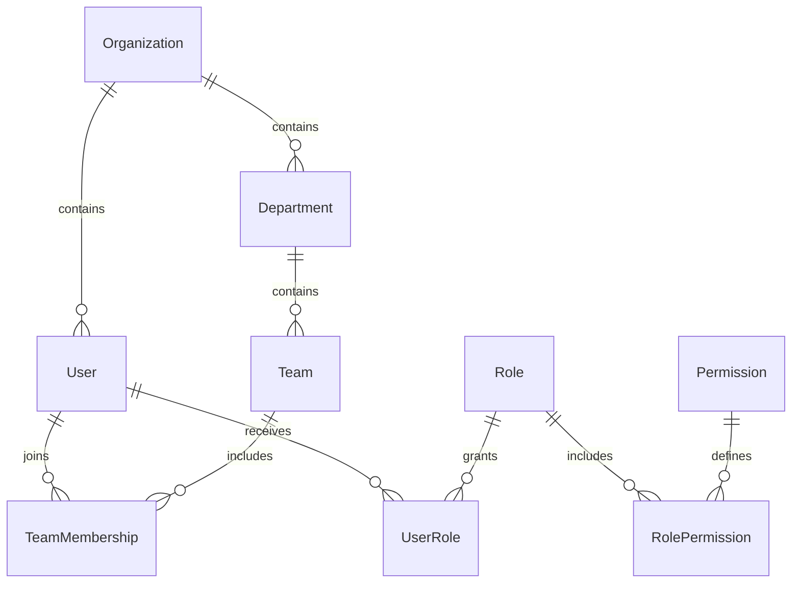
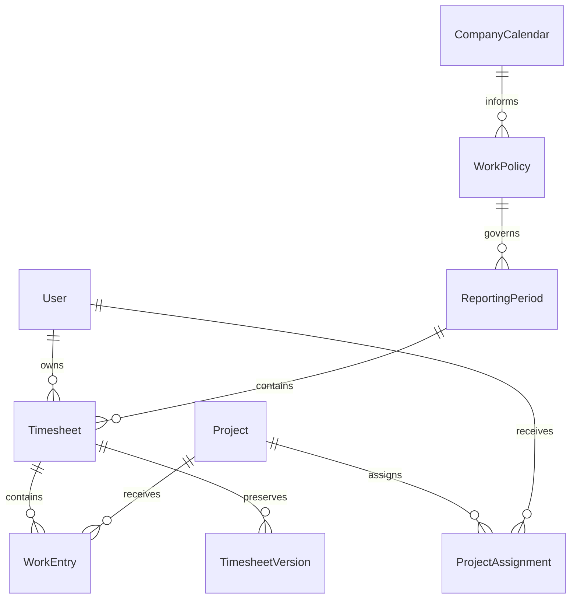
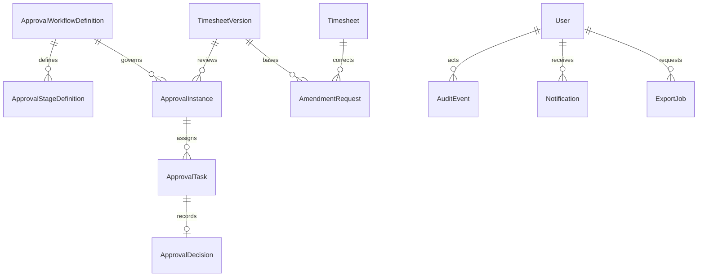

# KSRcodes pvt.ltd — application architecture

This repository is an incremental implementation, not a production acceptance certificate.

## Modules and data flow

The browser and API share an origin in production. React Router supplies application navigation; TanStack Query caches server responses. React Hook Form and Zod validate entry forms; Express applies independent server validation. Controllers delegate timesheet state changes to transaction services. Domain durations are whole minutes and work dates are calendar dates, never browser activity.

## Decisions

- ADR-001: modular monolith, one deployment image and database. No distributed event infrastructure is justified for the supplied workload.
- ADR-002: backend Entra confidential-client flow, PKCE, state, nonce, explicit JWT verification and opaque database sessions. No tokens or role claims in browser storage.
- ADR-003: server permissions plus organization/team/project scopes. System administration grants configuration/access rights, not automatic business-content or approval rights.
- ADR-004: optimistic revisions and serializable transactions around edits, submission, review and amendment application. Mutation retries use actor-bound idempotency records for submission and decisions.
- ADR-005: immutable JSON snapshots and append-only decisions/audit triggers. Work entries are the editable/current view; versions are history. PostgreSQL superusers can defeat triggers: use separate runtime/migration roles, protected backups and an independently retained audit sink for stronger assurance.
- ADR-006: PostgreSQL for deployment; an explicitly development-only PGlite adapter runs the same SQL migrations and Prisma services where a native database is unavailable. PGlite does not prove native PostgreSQL behavior, network isolation, backup restoration or production load capacity.
- ADR-007: serve frontend and backend from an Azure Container App, with private PostgreSQL Flexible Server. Azure provisioning requires customer environment/network/identity decisions. A static Sites deployment would not run this Express/PostgreSQL backend, so it is not substituted for the requested stack.

## State machines

Timesheet: DRAFT → SUBMITTED (audit transition plus frozen version) → IN_APPROVAL → APPROVED, RETURNED or REJECTED. Return/reject cancels remaining tasks. Owner explicitly reopens to DRAFT and resubmits a new version. Successful submission creates its approval instance in the same transaction; unresolved or unauthorized approvers roll back the operation.

Amendment: APPROVED timesheet → separate IN_REVIEW amendment → APPROVED or REJECTED request. Ordinary editing remains blocked. Approved corrections create a new approved version and preserve the prior snapshot. One open amendment per timesheet; current approved version must still equal its base version. Decision revisions may increase during review without changing that approved base.

Workflow: ordered stages numbered 1..N; REPORTING_MANAGER, PROJECT_MANAGER and HR_GROUP resolvers; ALL configured approvers must approve. Future-stage tasks exist but cannot be decided before their stage. In-flight instances retain their workflow ID/version and resolved approvers. Delegation and escalation are disabled, not simulated.

## Entity relationships

`prisma/schema.prisma` is the authoritative complete relation model, including sessions, transient sign-in requests, idempotency records and reserved outbox support. All historical foreign keys restrict deletion. Database migration adds monthly boundaries, positive duration checks, assignment date checks, scoped grant checks, unique active workflows/open amendments and history triggers.

## Permission matrix

| Role | Content scope | Draft write | Decisions | Organization | Configuration | Access administration |
|---|---|---|---|---|---|---|
| Employee | Own | Own draft | No | No | No | No |
| Manager | Assigned team | Own only | Assigned task within team | Read team | No | No |
| ProjectManager | Authorized project entries/reports | Only if separately Employee | Assigned project task | No | No | No |
| HR | Explicit organization or team scope | Own only | Assigned task within grant | Write only with organization grant | Organization-scoped permission | No |
| SystemAdmin | No automatic employee-content grant | Only if separately Employee | No automatic grant | No automatic business grant | Yes | Yes |
| Auditor | Explicit read scope | No | No | No | No | No |

Read-only audit access never changes history. Role names are not taken from request bodies as authority. Development seed roles are persisted in the same permission model used by production.

## Reporting

Recorded = current work entries. Submitted = latest submitted snapshot per employee/month, including returned submissions as historical submitted work. Approved = latest APPROVED/AMENDMENT_APPROVED snapshot. Versions are never summed together. Billable/non-billable effort uses recorded entries. Expected minutes = configured weekdays × configured target minutes less configured holidays. Project-only reports exclude unrelated project content and do not invent an employee-wide expected target.

CSV is generated synchronously over a bounded monthly scope of at most 1,000 users. Formula-leading cells are prefixed safely, and quoting handles commas, quotes and line breaks. Export events are audited. Async export storage/download is not enabled.
